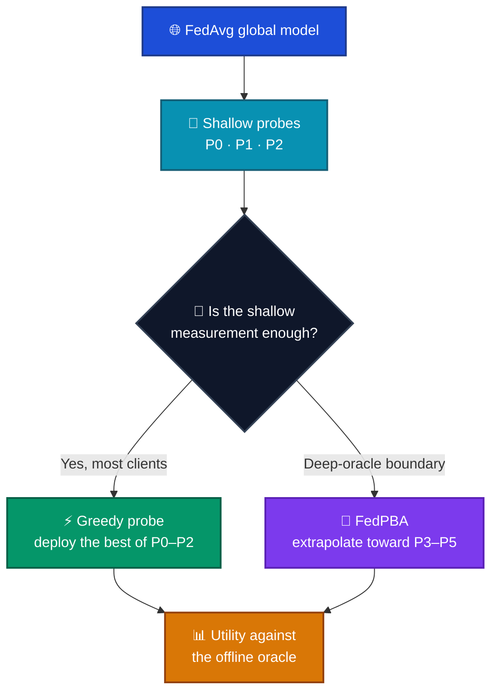

# 🔎 Shallow Probes Are Sufficient

**Near-oracle personalization depth allocation in federated learning**

[](https://sinconference.org/)
[](https://sinconference.org/)
[](requirements.txt)
[](LICENSE)

> Three shallow probes can choose a personalization depth that stays close to an offline oracle, without evaluating every deeper option.

## 🏛️ Conference

| | |
| --- | --- |
| 🎤 Event | **18th International Conference on Security of Information and Networks (SINCONF / SIN 2026)** |
| 📅 Dates | **14–16 October 2026** |
| 📍 Venue | Beykent University, Istanbul, Türkiye |
| 🔗 Site | [sinconference.org](https://sinconference.org/) |

## 👥 Authors

| | | |
| --- | --- | --- |
| 🎓 **Beyazıt Bestami Yüksel** | Istanbul Technical University | yukselbe18@itu.edu.tr |
| 🎓 **Emrah Dikbıyık** | Marmara University | emrah.dikbiyik@marmara.edu.tr |
| 🎓 **Ayşe Yılmazer Metin** | Istanbul Technical University | yilmazerayse@itu.edu.tr |

## 📄 Paper

Camera-ready PDF: [`paper/sinconf2026_camera_ready.pdf`](paper/sinconf2026_camera_ready.pdf)

**Shallow Probes Are Sufficient for Near-Oracle Personalization Depth Allocation in Federated Learning**

The offline oracle scores every depth \(P_0,\ldots,P_5\) with

\[
U_i(a)=\mathrm{Macro\text{-}F1}_i(a)-\lambda\,\mathrm{Cost}_i(a).
\]

That search is informative and not deployable. This study asks whether probes at \(P_0\), \(P_1\), and \(P_2\) already contain most of the decision-relevant information.

| 📌 Check | 📈 Camera-ready audit |
| --- | --- |
| ⚡ Greedy probe regret | **0.0071** |
| 🎯 Oracle recovery | **98.3%** |
| 🧠 FedPBA regret / recovery | 0.0110 / 97.3% |
| 🔗 Shallow-best vs oracle | \(r = 0.9818\) (deep-oracle rows: \(0.578\)) |
| 🧪 Scale | 45 sessions · 900 clients · 2700 evaluations · GroupKFold |

Datasets: **CIFAR-10**, **CIFAR-100**, and **patient-disjoint PTB-XL** (Lead II). FedPBA is a learned check for deep-action extrapolation, not a new federated optimizer. PTB-XL deep-oracle clients remain the failure boundary.

## 🗺️ How a decision is made



## 🗂️ What is in this repository

```
fedpbg/        federation, data, cost, and utility library
paper2/src/    probe policies, FedPBA, and the methodology audit
scripts/       patient-disjoint PTB-XL sessions and the v2/v3 runners
paper/         camera-ready PDF
```

Session caches, draft manuscripts, the arXiv upload bundle, templates, and conference photos stay on the machine that produced the paper. They are not part of this repository.

## 🚀 Run

```bash
python -m venv .venv
# Windows: .venv\Scripts\activate
# Linux/macOS: source .venv/bin/activate
pip install -r requirements.txt
```

CIFAR-10/100 download through torchvision. PTB-XL 1.0.3 goes in `data/ptbxl/` (`ptbxl_database.csv` and `records500/`). Waveforms are not in git.

```bash
python scripts/run_ptbxl_patient_disjoint_sessions.py
python scripts/run_methodology_v2_pipeline.py
python scripts/run_final_revision_v3.py
```

A full PTB-XL retrain wants a GPU. The camera-ready numbers above are the published audit, not a fresh local run.

## 📜 License

Code is released under the [MIT License](LICENSE). The manuscript PDF is the authors’ scholarly work.
